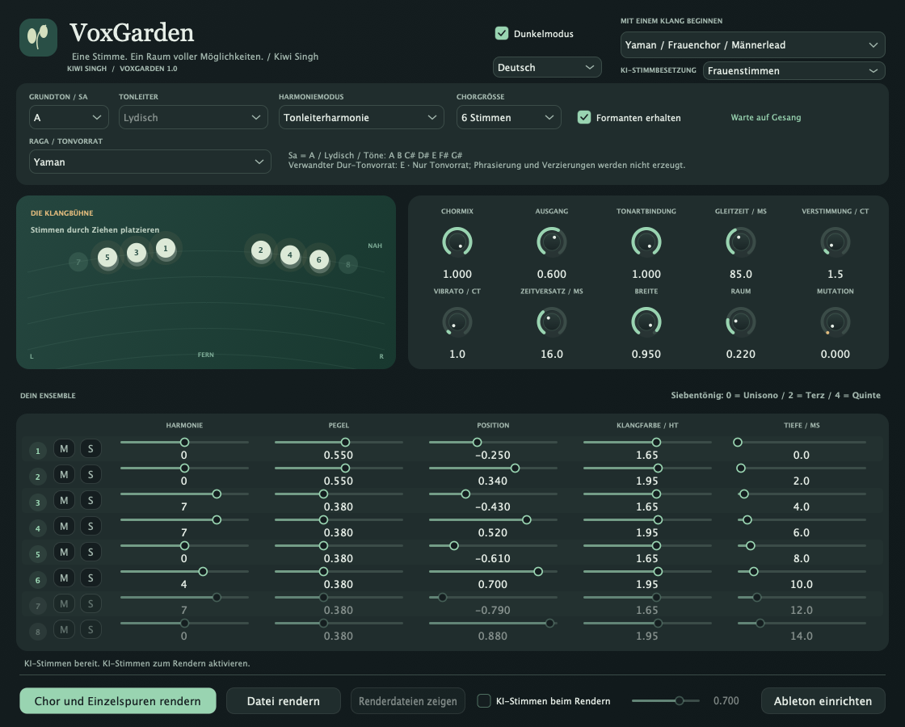
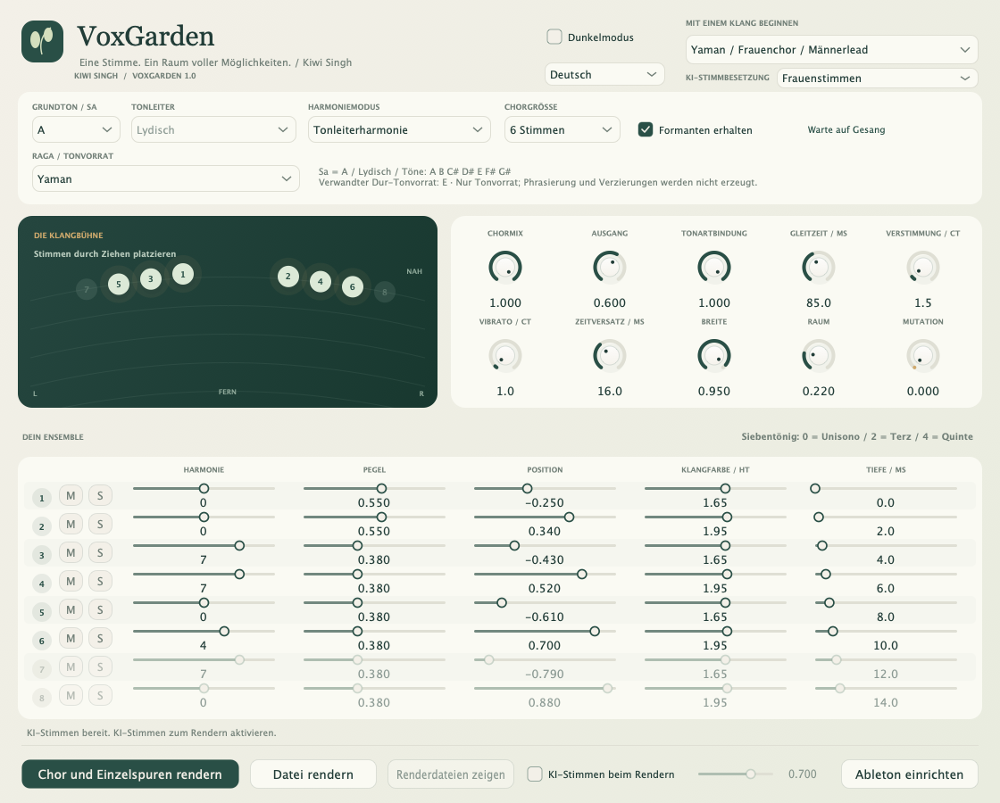

# VoxGarden — Kiwi Singh

[English](README.md) · [हिन्दी](README.hi.md) · **Deutsch** · [Nederlands](README.nl.md) · [Русский](README.ru.md)

Ein tonartbezogener Gesangschor-Effekt von **Kiwi Singh**: natürliche Begleitstimmen, kreative Stimmverwandlungen und optionales lokales KI-Rendern. **Version 1.0.0** · Apple-Silicon-macOS · VST3 + Standalone.

## Screenshots



<details><summary>Helles Thema</summary>



</details>

## Funktionen

- **1–8 Chorstimmen**, jeweils mit Harmonie, Pegel, Panorama, Formanten und Tiefe; Stummschaltung und kombinierbare Solos pro Stimme.
- **62 Werksklänge**, darunter Frauenchor für Männerlead und Männerchor für Frauenlead.
- **Acht Raga-Familien:** Yaman, Bhupali, Kafi, Bhairavi, Bhairav, Malkauns, Durga und Hamsadhwani. Jede bietet den Originalklang und beide Besetzungsvarianten, mit westlichen Tonvorräten und transponierten Noten.
- Tonleiterharmonie, MIDI-Akkorde, chromatische Intervalle sowie Timing, Verstimmung, Vibrato, Raum und experimentelle Mutation.
- **Eingang der eigenen Spur aufnehmen**, danach Chormix und zeitlich ausgerichtete Einzelspuren rendern. Aufnahme und Rendern verwenden trockenes Monitoring.
- Optionales **Seed-VC-KI-Rendern** mit Frauen-, Männer-, ursprünglicher Mischbesetzung oder abwechselnden Referenzstimmen. Nach der Einrichtung lokal und offline.
- Helles/dunkles Thema und Englisch, Hindi, Deutsch, Niederländisch und Russisch; Sprache je Instanz gespeichert.

## Download und Installation

[**v1.0.0 für Apple-Silicon-macOS herunterladen**](https://github.com/KiwiSingh/VoxGarden/releases/download/v1.0.0/VoxGarden-1.0-macOS-arm64.zip) · [Alle Releases](https://github.com/KiwiSingh/VoxGarden/releases)

1. ZIP entpacken und den Audiohost schließen.
2. **Install.command** starten. Das VST3 wird im Benutzer-Pluginordner installiert; eine ältere VoxGarden-Installation wird gesichert.
3. Ableton Live öffnen/neu scannen: **VST3 → Kiwi Singh → VoxGarden**.

Eine Standalone-App ist enthalten. Ziel des nativen Builds ist macOS 12+; die Binärdateien sind arm64. Keine Intel-/Windows-/Linux-Binärdateien und kein AU-Paket. Der Build ist ad-hoc signiert, nicht von Apple notarisiert. Der Installer repariert den Downloadmarker nur für dieses signaturgeprüfte Plugin.

## Verwendung in Ableton Live

**Grundton / Sa** des Songs wählen, dann Tonleiter oder Raga und Startklang. Unter **Raga-inspirierte Chöre** bietet jedes Raga-Untermenü drei Varianten. Westliche Bezüge beschreiben den gewählten Tonvorrat, keine automatische Tonarterkennung. [Raga-/Noten-Leitfaden](Ragas.md).

**Chor und Einzelspuren rendern** anklicken, die Passage in Live abspielen, dann **Stoppen und rendern**. VoxGarden nimmt vor seiner eigenen Verarbeitung auf, einschließlich früherer Effekte der Spur. Unter `Music/VoxGarden Renders` liegen Originalaufnahme, Choir Mix und nummerierte Stimmen-WAVs. Der Render nutzt die Einstellungen beim Stoppen, keine aufgezeichnete Parameterautomation. Dateirendern und Drag-and-drop sind ebenfalls möglich.

**M** schaltet stumm und erhält den Pegel. Mehrere **S**-Solos kombinieren sich; Stumm hat Vorrang. Chormix auf 100% setzen, um nur die Solostimmen ohne trockenen Lead zu hören. Ausgeschlossene Einzelspuren bleiben zeitlich ausgerichtet und stumm.

Delay Compensation aktivieren: etwa **192 ms DSP-Latenz bei 48 kHz**. Lead zunächst trocken aufnehmen. MIDI-Akkorde mit Lives Recorder aufzeichnen. SnappySnapFX kann unterschiedliche Parameterzustände als Snaps hosten; vollständiges Morphing in einer aktivierten Kopie ist nicht verifiziert.

## Optionale KI-Stimmen

**Setup AI.command** aus dem Release einmal ausführen oder im Quellbaum `bash "AI/Setup AI.command"` starten. Benötigt Git und **uv** oder **Python 3.10**, Internetzugang und mehrere GB für die Ersteinrichtung. Bereits geladene Modelle können bei Updates weiterverwendet werden.

**KI-Stimmen beim Rendern** aktivieren und **KI-Stimmbesetzung** wählen. Live bleibt DSP; neuronale Konvertierung erfolgt beim Rendern. Ergebnisdateien in Live importieren, um den KI-Klang zu hören. Längere Aufnahmen und größere Chöre brauchen mehr Zeit; Fortschritt zeigt Stimme und Syntheseschritte. Abbrechen behält die Quelle.

Das VCTK-Paket enthält fünf weibliche und drei männliche Sprachreferenzen, die bei größeren Besetzungen wiederverwendet werden. Es ist kein gesampelter Profichor. Aussprache, Timing und Natürlichkeit hängen von der Quelle ab. Raga-Masken begrenzen Noten; Pakad, Meend, Gamakas und richtungsabhängige Phrasierung kommen weiterhin aus dem Gesang. [KI-Details](AI/README.md) · [Stimmencredits](AI/Voices/ATTRIBUTION.txt).

## Aus Quellcode bauen

C++17-Werkzeugkette, CMake 3.24+, Ninja und Git auf macOS erforderlich. Abhängigkeiten sind auf Commits festgelegt.

```sh
git clone https://github.com/KiwiSingh/VoxGarden.git
cd VoxGarden
bash prepare-deps.sh
cmake -S . -B build -G Ninja -DCMAKE_BUILD_TYPE=Release -DCMAKE_OSX_ARCHITECTURES=arm64
cmake --build build --target VoxGarden_VST3 VoxGarden_Standalone VoxGardenCheck
ctest --test-dir build --output-on-failure
```

Ergebnisse: `build/VoxGarden_artefacts/Release`. Siehe [Validierung](VALIDATION.txt), [Audit](Audit-1.0.md) und [Beiträge](CONTRIBUTING.md). Keine KI-Gewichte oder privaten Gesangsaufnahmen im Repository.

## Lizenz und Credits

VoxGarden nutzt **GNU AGPL v3**, siehe [LICENSE](LICENSE). Abhängigkeiten behalten ihre Lizenzen: [JUCE](Licenses/JUCE.md), [Signalsmith Stretch](Licenses/Signalsmith-Stretch.txt), [Signalsmith Linear](Licenses/Signalsmith-Linear.txt), [Seed-VC GPL v3](Licenses/Seed-VC-GPL-3.0.txt). VCTK-Referenzen: **CC BY 4.0**, mit Attribution und Metadaten in [AI/Voices](AI/Voices). Unabhängiges Projekt ohne Cymatics-Code, -Assets oder -Presets.

## ☕️ Das Projekt unterstützen

[](https://ko-fi.com/kiwisingh)
