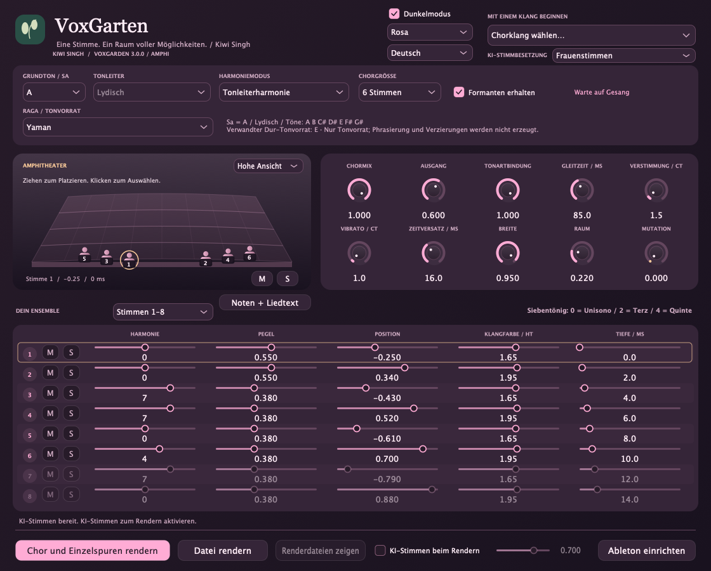
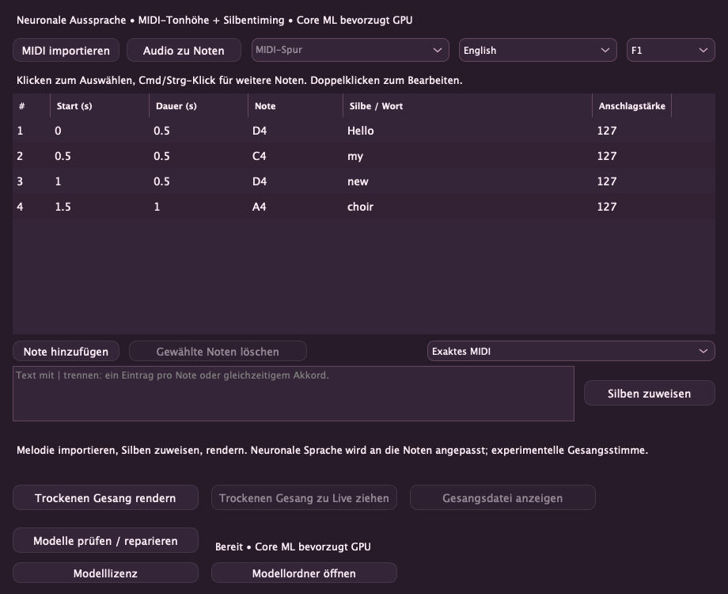

# VoxGarden — Kiwi Singh

[English](README.md) · [हिन्दी](README.hi.md) · **Deutsch** · [Nederlands](README.nl.md) · [Русский](README.ru.md)

Ein tonartbezogener Gesangschor-Effekt von **Kiwi Singh**: natürliche Begleitstimmen, kreative Stimmverwandlungen und optionales lokales KI-Rendern. **Version 3.0.0 — Amphi** · Apple-Silicon-macOS · VST3 + Standalone.

## Neu in 3.0 „Amphi“: 24 Stimmen und gemerktes Design

VoxGarden 3.0 Amphi bietet **1–24 Chorstimmen** in drei Achterbänken mit separatem Mute/Solo und Stimmreglern. **Abtei-Ensemble 24**, **Kammerensemble 16** und **Samtige Abtei 24** sind eigene DSP-Klänge, keine Cymatics-Aufnahmen oder Abbey-Road-Samples. Ungenutzte Stimmen überspringen die Tonhöhenbearbeitung. Das zuletzt gewählte Design samt Hell/Dunkel wird Standard für neue Instanzen; Projekte behalten ihr eigenes Design, ohne den Standard zu ändern. Alte 2.0-Parameter und Achtstimmenklänge bleiben erhalten; neue Regler werden angehängt.


### Amphitheater und Genre-Klänge

Amphi bietet ein eigenes **perspektivisches Amphitheater**: hohe/flache Ansicht, nummerierte Sänger, Auswahl per Klick mit passender Bank-/Zeilenmarkierung sowie direkte **M/S**-Regler für die gewählte Stimme. Ziehen ändert Pan und Tiefe; Klick und Kamera ändern den Klang nicht. Deckungsgleiche Stimmen werden nur visuell getrennt und bleiben einzeln auswählbar.

Bollywood, Italodisco, Disco polo und Klassik erhalten **12 neue Ausgangsklänge**, insgesamt **77**. Grundton und gewählte Tonleiter/Raga bleiben erhalten. Raga-Begleitung verwendet die gewählte Notensammlung statt automatisch eine Raga auszuwählen. DSP-Ausgangspunkte, keine gesampelten Chöre oder vollständigen Genre-Arrangements.

## Screenshots



## Neu in 2.0: Noten + Liedtext und farbige Themen

Der Quellcode enthält einen **experimentellen Noten-zu-Gesang-Arbeitsbereich**: Standard-MIDI importieren, Melodiespur wählen, Unicode-Silben zuweisen und Notennamen, Start und Dauer in einer Tabelle bearbeiten. Isoliertes Audio liefert eine editierbare einstimmige Notenskizze. **Stimmen direkt im Plugin laden** (~401 MB Modelle plus eigene Laufzeit/Cache), eine von zehn Stimmen wählen und trockenen Gesang rendern und mit **Trockenen Gesang zu Live ziehen** auf die Audiospur mit VoxGarden ziehen, um Harmonien vor dem Rendern anzuhören und einzustellen. **Supertonic 3 für neuronale Aussprache + PSOLA** für Zeit/Tonhöhe unterstützt Englisch, Hindi in Devanagari, Deutsch, Japanisch, Russisch und Niederländisch. **Core ML bevorzugt die GPU**; Zeitbearbeitung und nicht unterstützte Graphoperationen laufen auf der CPU. Dies ist an Noten angepasste Sprache, kein trainiertes Gesangsmodell; Natürlichkeit bitte anhören. **Rosa, Ozean und Sonnenuntergang** bieten helle/dunkle Varianten. [Ablauf, Messwerte und Grenzen (Englisch)](Singing.md).




<details><summary>Rose / 🌸</summary>


</details>

MIDI-Akkorde und überlappende Noten behalten ihre Dauer, auch bei wiederholten Tonhöhen. Klicken wählt eine Zeile; Cmd/Strg-Klick wählt mehrere Noten, Umschalt-Klick einen Bereich, Doppelklick bearbeitet eine Zelle. Text kann pro Note oder gleichzeitigem Akkord zugewiesen werden.

## SnappySnap-Unterstützung

VoxGarden VST3 als Effekt in **SnappySnapFX** laden und unterschiedliche Einstellungen für Harmonie, Stimmenzahl, Formanten und Mutation als **Snaps** speichern. So kann der Chor zwischen natürlichen und ungewöhnlichen Klängen wechseln. Klangparameter und Wiederherstellung des Host-Zustands werden unterstützt. Der Nutzer hat den vollständigen Morphing-Ablauf mit der offiziellen siebentägigen SnappySnapFX-Testversion von Electric Smudge bestätigt. Offline-KI- und Gesangsrender sind Dateien, keine in Echtzeit morphbare Synthese.

## Funktionen

- **SnappySnapFX-Unterstützung:** VoxGarden hosten und verschiedene Klangeinstellungen als Snaps speichern; Kompatibilitätshinweise unten.
- **1–24 Chorstimmen**, jeweils mit Harmonie, Pegel, Panorama, Formanten und Tiefe; Stummschaltung und kombinierbare Solos pro Stimme.
- **77 Werksklänge**, darunter Frauenchor für Männerlead und Männerchor für Frauenlead.
- **Acht Raga-Familien:** Yaman, Bhupali, Kafi, Bhairavi, Bhairav, Malkauns, Durga und Hamsadhwani. Jede bietet den Originalklang und beide Besetzungsvarianten, mit westlichen Tonvorräten und transponierten Noten.
- Tonleiterharmonie, MIDI-Akkorde, chromatische Intervalle sowie Timing, Verstimmung, Vibrato, Raum und experimentelle Mutation.
- **Eingang der eigenen Spur aufnehmen**, danach Chormix und zeitlich ausgerichtete Einzelspuren rendern. Aufnahme und Rendern verwenden trockenes Monitoring.
- Optionales **Seed-VC-KI-Rendern** mit Frauen-, Männer-, ursprünglicher Mischbesetzung oder abwechselnden Referenzstimmen. Nach der Einrichtung lokal und offline.
- Helles/dunkles Thema und Englisch, Hindi, Deutsch, Niederländisch und Russisch; Sprache je Instanz gespeichert.

## Download und Installation

[**v3.0.0 für Apple-Silicon-macOS herunterladen**](https://github.com/KiwiSingh/VoxGarden/releases/download/v3.0.0/VoxGarden-3.0.0-Amphi-macOS-arm64.zip) · [Alle Releases](https://github.com/KiwiSingh/VoxGarden/releases)

1. ZIP entpacken und den Audiohost schließen.
2. **Install.command** starten. Das VST3 wird im Benutzer-Pluginordner installiert; eine ältere VoxGarden-Installation wird gesichert.
3. Ableton Live öffnen/neu scannen: **VST3 → Kiwi Singh → VoxGarden**.

Eine Standalone-App ist enthalten. Ziel des nativen Builds ist macOS 12+; die Binärdateien sind arm64. Keine Intel-/Windows-/Linux-Binärdateien und kein AU-Paket. Der Build ist ad-hoc signiert, nicht von Apple notarisiert. Der Installer repariert den Downloadmarker nur für dieses signaturgeprüfte Plugin.

## Verwendung in Ableton Live

**Grundton / Sa** des Songs wählen, dann Tonleiter oder Raga und Startklang. Unter **Raga-inspirierte Chöre** bietet jedes Raga-Untermenü drei Varianten. Westliche Bezüge beschreiben den gewählten Tonvorrat, keine automatische Tonarterkennung. [Raga-/Noten-Leitfaden](Ragas.md).

**Chor und Einzelspuren rendern** anklicken, die Passage in Live abspielen, dann **Stoppen und rendern**. VoxGarden nimmt vor seiner eigenen Verarbeitung auf, einschließlich früherer Effekte der Spur. Unter `Music/VoxGarden Renders` liegen Originalaufnahme, Choir Mix und nummerierte Stimmen-WAVs. Der Render nutzt die Einstellungen beim Stoppen, keine aufgezeichnete Parameterautomation. Dateirendern und Drag-and-drop sind ebenfalls möglich.

**M** schaltet stumm und erhält den Pegel. Mehrere **S**-Solos kombinieren sich; Stumm hat Vorrang. Chormix auf 100% setzen, um nur die Solostimmen ohne trockenen Lead zu hören. Ausgeschlossene Einzelspuren bleiben zeitlich ausgerichtet und stumm.

Delay Compensation aktivieren: etwa **192 ms DSP-Latenz bei 48 kHz**. Lead zunächst trocken aufnehmen. MIDI-Akkorde mit Lives Recorder aufzeichnen. SnappySnapFX kann unterschiedliche Parameterzustände als Snaps hosten. Der Nutzer hat Morphing mit der offiziellen Testversion von Electric Smudge bestätigt.

Zum Ziehen von einer anderen Spur in Live **Settings → Plug-Ins → Auto-Hide Plug-In Windows** ausschalten und **Noten + Liedtext** öffnen. Dieses Fenster bleibt über dem Host. MIDI-Clips zuerst als .mid exportieren; direktes Ziehen interner MIDI-Clips ist eine bekannte Einschränkung.

## Optionale KI-Stimmen

Die neuen Gesangsmodelle werden in **Noten + Liedtext** geladen. Die folgende separate Einrichtung betrifft nur die ältere Seed-VC-Stimmkonvertierung.

**Setup AI.command** aus dem Release einmal ausführen oder im Quellbaum `bash "AI/Setup AI.command"` starten. Benötigt Git und **uv** oder **Python 3.10**, Internetzugang und mehrere GB für die Ersteinrichtung. Bereits geladene Modelle können bei Updates weiterverwendet werden.

**KI-Stimmen beim Rendern** aktivieren und **KI-Stimmbesetzung** wählen. Live bleibt DSP; neuronale Konvertierung erfolgt beim Rendern. Ergebnisdateien in Live importieren, um den KI-Klang zu hören. Längere Aufnahmen und größere Chöre brauchen mehr Zeit; Fortschritt zeigt Stimme und Syntheseschritte. Abbrechen behält die Quelle.

Das VCTK-Paket enthält fünf weibliche und drei männliche Sprachreferenzen, die bei größeren Besetzungen wiederverwendet werden. Es ist kein gesampelter Profichor. Aussprache, Timing und Natürlichkeit hängen von der Quelle ab. Raga-Masken begrenzen Noten; Pakad, Meend, Gamakas und richtungsabhängige Phrasierung kommen weiterhin aus dem Gesang. [KI-Details](AI/README.md) · [Stimmencredits](AI/Voices/ATTRIBUTION.txt).

## Aus Quellcode bauen

C++17-Werkzeugkette, CMake 3.24+, Ninja und Git auf macOS erforderlich. Abhängigkeiten sind auf Commits festgelegt.

```sh
git clone https://github.com/KiwiSingh/VoxGarden.git
cd VoxGarden
bash prepare-deps.sh
cmake -S . -B build -G Ninja -DCMAKE_BUILD_TYPE=Release -DCMAKE_OSX_ARCHITECTURES=arm64
cmake --build build --target VoxGarden_VST3 VoxGarden_Standalone VoxGardenCheck
ctest --test-dir build --output-on-failure
```

Ergebnisse: `build/VoxGarden_artefacts/Release`. Siehe [Validierung](VALIDATION.txt), [Audit](Audit-1.0.md) und [Beiträge](CONTRIBUTING.md). Keine KI-Gewichte oder privaten Gesangsaufnahmen im Repository.

## Lizenz und Credits

VoxGarden nutzt **GNU AGPL v3**, siehe [LICENSE](LICENSE). Abhängigkeiten behalten ihre Lizenzen: [JUCE](Licenses/JUCE.md), [Signalsmith Stretch](Licenses/Signalsmith-Stretch.txt), [Signalsmith Linear](Licenses/Signalsmith-Linear.txt), [Seed-VC GPL v3](Licenses/Seed-VC-GPL-3.0.txt). VCTK-Referenzen: **CC BY 4.0**, mit Attribution und Metadaten in [AI/Voices](AI/Voices). Unabhängiges Projekt ohne Cymatics-Code, -Assets oder -Presets.

## Akkordgeführter Gesang

Unter **Notes + lyrics** stehen exaktes MIDI, anschlaggeführte und grundtongeführte Akkorde bereit. MIDI-Anschlagstärke (1–127) wird importiert und ist editierbar. Akkordmodi gruppieren Noten mit mindestens 30 ms gemeinsamer Überlappung oder höchstens 2 ms Startabstand. Sie teilen das Wort der führenden Note und mischen diese lauter als die Harmonien. Eine Silbe pro Gruppe oder Note zuweisen. Der Anschlagmodus wählt die stärkste Note, bei Gleichstand die tiefste. Der Grundtonmodus erkennt gängige Drei- und Septakkorde samt Umkehrungen; unsichere Grundtöne fallen auf den Bass zurück. Originalnoten und Dauern bleiben erhalten. Gesteuert werden Wortverteilung und Pegel, keine expressive neuronale Betonung.

**Ableton-MIDI-Import:** Clip zuerst als `.mid` exportieren, dann diese Datei in VoxGarden importieren oder hineinziehen. Direktes Ziehen interner MIDI-Clips ist eine bekannte Einschränkung. Trockene WAV-Übertragung und Anhören in Live sind vom Nutzer bestätigt. Neuronaler Gesang benötigt Apple Silicon macOS 14+; das DSP-Plugin zielt auf macOS 12+.

## ☕️ Das Projekt unterstützen

[](https://ko-fi.com/kiwisingh)
