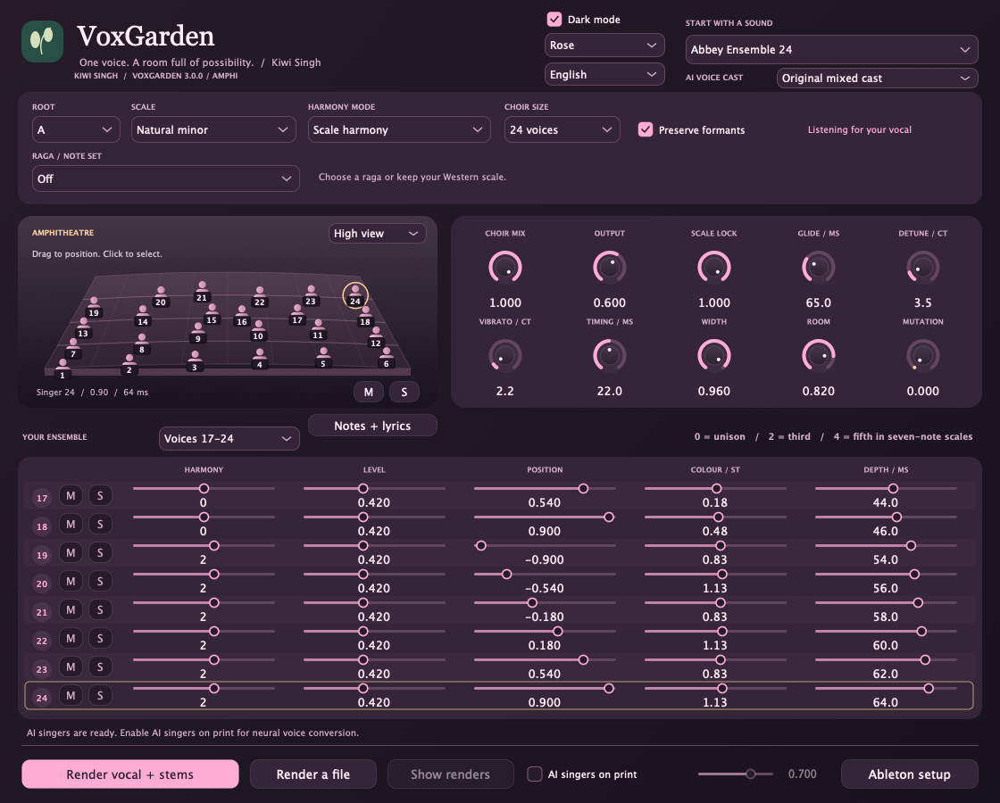
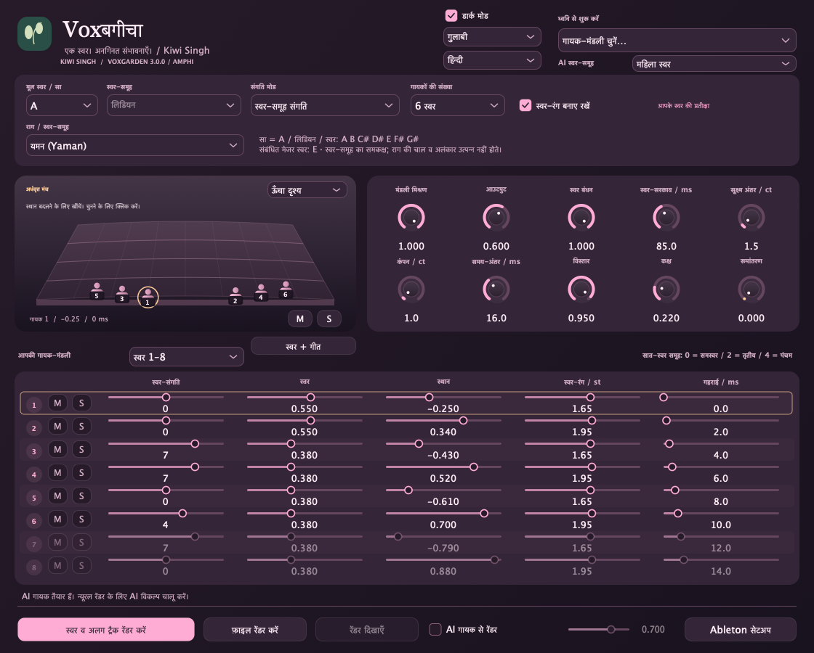
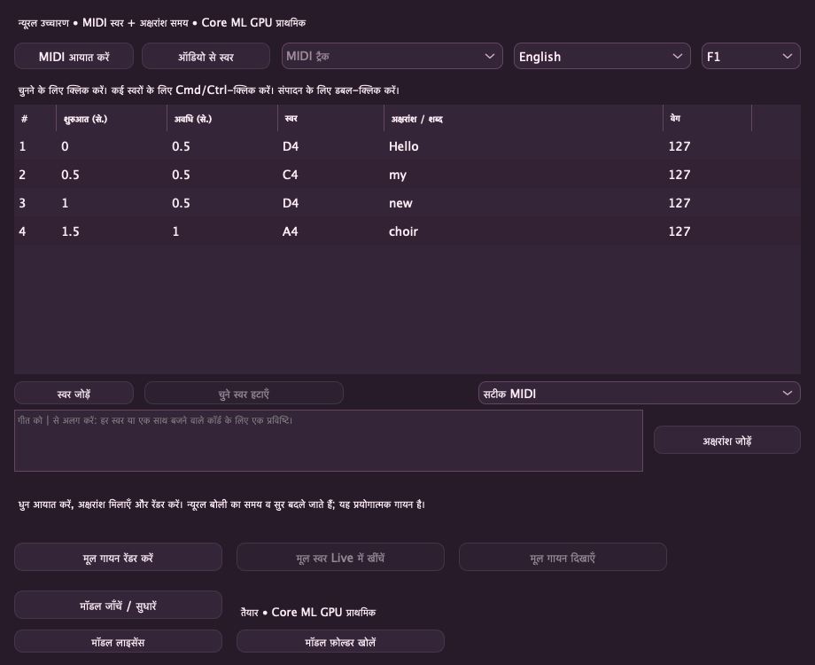

# VoxGarden — Kiwi Singh

[English](README.md) · **हिन्दी** · [Deutsch](README.de.md) · [Nederlands](README.nl.md) · [Русский](README.ru.md)

**Kiwi Singh** का स्वर-समूह आधारित गायन-कोरस प्लगइन: स्वाभाविक सहगान, मज़ेदार स्वर-रूपांतरण और वैकल्पिक स्थानीय AI रेंडर। **संस्करण 3.0.0 — Amphi** · Apple Silicon macOS · VST3 व स्टैंडअलोन।

## 3.0 “Amphi” में नया: 24 स्वर और याद रहने वाली थीम

VoxGarden 3.0 Amphi में **1–24 मंडली स्वर** हैं, तीन आठ-स्वर बैंकों में अलग म्यूट/सोलो व स्वर नियंत्रण के साथ। **ऐबी मंडली 24**, **चेम्बर मंडली 16** और **मखमली ऐबी 24** मूल DSP ध्वनियाँ हैं; Cymatics रिकॉर्डिंग या Abbey Road सैंपल नहीं। अप्रयुक्त स्वर पिच प्रोसेसिंग नहीं चलाते। अंतिम चुनी थीम व हल्का/डार्क रूप नए इंस्टेंस का डिफ़ॉल्ट बनते हैं; परियोजना अपनी थीम रखती है और डिफ़ॉल्ट नहीं बदलती। पुराने 2.0 पैरामीटर व आठ-स्वर ध्वनियाँ सुरक्षित हैं; नए नियंत्रण अंत में जोड़े गए हैं।



### अर्धवृत्त मंच और शैली-आधारित ध्वनियाँ

Amphi में मूल **परिप्रेक्ष्य वाला अर्धवृत्त मंच** है: ऊँचा/नीचा दृश्य, अलग अंकित गायक, क्लिक करके चयन और संबंधित बैंक/पंक्ति पर प्रकाश, तथा चुने गायक के सीधे **M/S** नियंत्रण। खींचने से पैन व गहराई बदलते हैं; क्लिक या कैमरा बदलने से ध्वनि नहीं बदलती। एक ही स्थान वाले गायकों को केवल दृश्य में अलग रखा जाता है ताकि हर स्वर चुना जा सके।

बॉलीवुड, इटालोडिस्को, डिस्को पोलो और शास्त्रीय संगीत के लिए **12 शुरुआती ध्वनियाँ** जोड़ी गई हैं; कुल **77**। सभी चुना मूल स्वर व स्केल/राग बनाए रखते हैं। राग सहगान नया राग नहीं चुनता, आपकी चुनी स्वर-संगति उपयोग करता है। ये DSP शुरुआती ध्वनियाँ हैं, सैंपल मंडली या पूरी शैली की रचना नहीं।

## स्क्रीनशॉट



## 2.0 में नया: स्वर + गीत और रंगीन थीम

स्रोत में **प्रयोगात्मक स्वर-से-गायन कार्यक्षेत्र** है: मानक MIDI आयात करें, धुन ट्रैक चुनें, Unicode अक्षरांश जोड़ें और तालिका में स्वर, शुरुआत व अवधि बदलें। अलग एक स्वर वाले ऑडियो से संपादन योग्य स्वर रूपरेखा मिलती है। **प्लगइन के अंदर स्वर डाउनलोड करें** (~401 MB मॉडल, साथ में निजी रनटाइम/कैश), दस स्वरों में से चुनें और मूल गायन रेंडर करें, फिर **मूल स्वर Live में खींचें** से VoxGarden वाले ऑडियो ट्रैक पर डालें और प्रिंट करने से पहले हार्मनी सुनकर बदलें। **Supertonic 3 न्यूरल उच्चारण + PSOLA** समय/सुर नियंत्रण अंग्रेज़ी, देवनागरी हिंदी, जर्मन, जापानी, रूसी व डच चलाते हैं। न्यूरल अनुमान में **Core ML GPU को प्राथमिकता** देता है; समय/सुर बदलाव व असमर्थित ग्राफ़ भाग CPU पर चलते हैं। यह बोली को गायन में बदलने वाला प्रयोग है; स्वाभाविकता सुनकर जाँचें। **गुलाबी, समुद्री और सूर्यास्त** थीम में हल्का/डार्क रूप है। [प्रवाह, गति व सीमाएँ (अंग्रेज़ी)](Singing.md)।




<details><summary>Rose / 🌸</summary>


</details>

MIDI कॉर्ड और साथ बजते स्वर अपनी अवधि बनाए रखते हैं, दोहराए गए स्वर भी। पंक्ति चुनने के लिए क्लिक करें; कई स्वरों के लिए Cmd/Ctrl-क्लिक, सीमा के लिए Shift-क्लिक और संपादन के लिए डबल-क्लिक करें। गीत हर स्वर या एक साथ बजने वाले कॉर्ड को दे सकते हैं।

## SnappySnap समर्थन

**SnappySnapFX** में VoxGarden VST3 इफ़ेक्ट लोड करें और अलग हार्मनी, स्वर-संख्या, फ़ॉर्मैंट व Mutation सेटिंग **Snaps** में सहेजें। इससे प्राकृतिक से अनोखी मंडली तक बदल सकते हैं। ध्वनि पैरामीटर और होस्ट-स्टेट पुनर्स्थापन समर्थित हैं। उपयोगकर्ता ने Electric Smudge की आधिकारिक सात-दिन की SnappySnapFX ट्रायल प्रति में पूरा मॉर्फ़िंग प्रवाह काम करने की पुष्टि की है। ऑफ़लाइन AI/गायन रेंडर फ़ाइलें हैं, रियल-टाइम मॉर्फ़िंग इंजन नहीं।

## सुविधाएँ

- **SnappySnapFX समर्थन:** VoxGarden होस्ट करके अलग ध्वनि सेटिंग Snaps में सहेजें; नीचे संगतता विवरण देखें।
- **1–24 गायक**, हर स्वर के लिए संगति, स्तर, स्थान, फ़ॉर्मेंट और गहराई; अलग म्यूट और एक साथ कई सोलो।
- **77 प्रीसेट**, जिनमें पुरुष मुख्य स्वर के लिए महिला मंडली और महिला मुख्य स्वर के लिए पुरुष मंडली शामिल हैं।
- **आठ राग-प्रेरित परिवार:** यमन, भूपाली, काफ़ी, भैरवी, भैरव, मालकौंस, दुर्गा और हंसध्वनि। हर राग में मूल ध्वनि व दोनों स्वर-समूह रूप हैं; पश्चिमी स्वर-समूह के नाम और बदले हुए नोट भी दिखते हैं।
- स्वर-समूह संगति, MIDI कॉर्ड, अर्धस्वर अंतराल, समय-अंतर, सूक्ष्म स्वर-अंतर, कंपन, कक्ष और प्रयोगात्मक रूपांतरण।
- **उसी ट्रैक का मूल इनपुट रिकॉर्ड करें**, फिर मंडली और समय-मिलाए अलग स्वर रेंडर करें। रिकॉर्डिंग व रेंडर के दौरान मूल स्वर सुनाई देता है।
- वैकल्पिक **Seed-VC AI रेंडर**, महिला, पुरुष, मूल मिश्रित या बारी-बारी संदर्भ स्वरों के साथ। सेटअप के बाद रूपांतरण स्थानीय और ऑफ़लाइन होता है।
- लाइट/डार्क थीम और अंग्रेज़ी, हिन्दी, जर्मन, डच व रूसी इंटरफ़ेस; भाषा हर इंस्टेंस के साथ सहेजी जाती है।

## डाउनलोड और इंस्टॉल

[**Apple Silicon macOS के लिए v3.0.0 डाउनलोड करें**](https://github.com/KiwiSingh/VoxGarden/releases/download/v3.0.0/VoxGarden-3.0.0-Amphi-macOS-arm64.zip) · [सभी रिलीज़](https://github.com/KiwiSingh/VoxGarden/releases)

1. ZIP निकालें और अपना ऑडियो होस्ट बंद करें।
2. **Install.command** चलाएँ। VST3 उपयोगकर्ता के प्लगइन फ़ोल्डर में लगता है और पुराना VoxGarden सुरक्षित रखा जाता है।
3. Ableton Live खोलें/दोबारा स्कैन करें: **VST3 → Kiwi Singh → VoxGarden**।

पैकेज में स्टैंडअलोन ऐप भी है। मूल बिल्ड macOS 12+ को लक्षित करता है; बाइनरी arm64 है। Intel, Windows, Linux बाइनरी या AU पैकेज नहीं दिया गया है। बिल्ड ad-hoc signed है, Apple-notarized नहीं। इंस्टॉलर केवल इसी हस्ताक्षर-जाँचे प्लगइन का डाउनलोड चिह्न ठीक करता है।

## Ableton Live में उपयोग

गाने का **मूल स्वर / सा** चुनें, फिर पश्चिमी स्वर-समूह या राग और प्रीसेट चुनें। **राग-प्रेरित मंडलियाँ** में हर राग का उपमेनू तीन ध्वनियाँ देता है। पश्चिमी संबंध चुने हुए नोटों के हैं; गाने की कुंजी अपने-आप नहीं पहचानी जाती। [राग व पश्चिमी स्वर मार्गदर्शिका](Ragas.md)।

**स्वर व अलग ट्रैक रेंडर करें** दबाएँ, Live में अंश चलाएँ, फिर **रोकें व रेंडर करें** दबाएँ। रिकॉर्डिंग VoxGarden की अपनी प्रोसेसिंग से पहले, ट्रैक के पिछले इफ़ेक्ट सहित होती है। `Music/VoxGarden Renders` में मूल रिकॉर्डिंग, Choir Mix और क्रमांकित स्वर WAV मिलते हैं। रेंडर रुकने के समय की सेटिंग लेता है; रिकॉर्डिंग की ऑटोमेशन शामिल नहीं होती। फ़ाइल रेंडर और ड्रैग/ड्रॉप भी उपलब्ध हैं।

**M** स्तर बदले बिना स्वर बंद करता है। कई **S** सोलो साथ बजते हैं; म्यूट प्राथमिक है। केवल सोलो मंडली सुनने के लिए मिश्रण 100% रखें। बाहर किए गए स्वर की फ़ाइल मौन और समय-मिलाई रहती है।

Delay Compensation चालू रखें: 48 kHz पर DSP विलंब लगभग **192 ms** है। मुख्य स्वर पहले ड्राई रिकॉर्ड करें। MIDI कॉर्ड का प्रदर्शन Live के रिकॉर्डर से रिकॉर्ड करें। SnappySnapFX में अलग सेटिंग Snaps के रूप में सहेज सकते हैं। उपयोगकर्ता ने Electric Smudge की आधिकारिक ट्रायल प्रति में मॉर्फ़िंग की पुष्टि की है।

दूसरे ट्रैक से ड्रैग करने के लिए Live में **Settings → Plug-Ins → Auto-Hide Plug-In Windows** बंद करें, फिर **स्वर + गीत** खोलें। यह विंडो होस्ट के ऊपर रहती है। पहले MIDI क्लिप को .mid में निर्यात करें; आंतरिक MIDI क्लिप को सीधे खींचना अभी समर्थित नहीं है।

## वैकल्पिक AI गायक

नए स्वर-से-गायन मॉडल **स्वर + गीत** विंडो में डाउनलोड होते हैं। नीचे का अलग सेटअप केवल पुराने Seed-VC स्वर-रूपांतरण के लिए है।

रिलीज़ से **Setup AI.command** एक बार चलाएँ, या स्रोत में `bash "AI/Setup AI.command"` चलाएँ। Git और **uv** या **Python 3.10**, इंटरनेट तथा प्रारंभिक मॉडल के लिए कई GB स्थान चाहिए। अपडेट में पुराने मॉडल डाउनलोड फिर इस्तेमाल हो सकते हैं।

**AI गायक से रेंडर** चालू करें और **AI स्वर-समूह** चुनें। लाइव प्लेबैक DSP है; न्यूरल रूपांतरण केवल रेंडर में होता है। AI सुनने के लिए बना मिश्रण/स्वर Live में आयात करें। लंबे अंश और अधिक गायक अधिक समय लेते हैं; प्रगति में गायक और रचना चरण दिखते हैं। रद्द करने पर मूल रिकॉर्डिंग बचती है।

VCTK पैक में पाँच महिला और तीन पुरुष वाणी-संदर्भ हैं, जिन्हें बड़े समूहों में दोहराया जाता है। यह रिकॉर्ड की हुई पेशेवर गायक-मंडली नहीं है। उच्चारण, समय और स्वाभाविकता स्रोत पर निर्भर हैं। राग सुविधा नोट सीमित करती है; पकड़, मींड, गमक और विशेष आरोह-अवरोह आपके स्वर से आते हैं। [AI विवरण](AI/README.md) · [स्वर श्रेय](AI/Voices/ATTRIBUTION.txt)।

## स्रोत से बिल्ड

macOS पर C++17 टूलचेन, CMake 3.24+, Ninja और Git चाहिए। निर्भरताएँ निश्चित कमिट पर हैं।

```sh
git clone https://github.com/KiwiSingh/VoxGarden.git
cd VoxGarden
bash prepare-deps.sh
cmake -S . -B build -G Ninja -DCMAKE_BUILD_TYPE=Release -DCMAKE_OSX_ARCHITECTURES=arm64
cmake --build build --target VoxGarden_VST3 VoxGarden_Standalone VoxGardenCheck
ctest --test-dir build --output-on-failure
```

बिल्ड `build/VoxGarden_artefacts/Release` में मिलेगा। [सत्यापन](VALIDATION.txt), [सुनने की जाँच](Audit-1.0.md) और [योगदान](CONTRIBUTING.md) देखें। AI वेट या निजी स्वर रिकॉर्डिंग रिपॉज़िटरी में नहीं हैं।

## लाइसेंस और श्रेय

VoxGarden का लाइसेंस **GNU AGPL v3** है: [LICENSE](LICENSE)। निर्भरताओं के लाइसेंस अलग हैं: [JUCE](Licenses/JUCE.md), [Signalsmith Stretch](Licenses/Signalsmith-Stretch.txt), [Signalsmith Linear](Licenses/Signalsmith-Linear.txt), [Seed-VC GPL v3](Licenses/Seed-VC-GPL-3.0.txt)। VCTK संदर्भ **CC BY 4.0** हैं; [AI/Voices](AI/Voices) में श्रेय व मूल विवरण हैं। परियोजना स्वतंत्र है; Cymatics का कोड, सामग्री या प्रीसेट शामिल नहीं है।

## कॉर्ड-प्रधान गायन

**Notes + lyrics** में सटीक MIDI, वेग-प्रधान कॉर्ड या कॉर्ड मूल स्वर चुनें। MIDI वेग (1–127) आयात होता है और बदला जा सकता है। कम-से-कम 30 ms का साझा ओवरलैप या 2 ms के भीतर शुरुआत वाले स्वर एक समूह बनते हैं। समूह प्रधान स्वर का शब्द साझा करता है; प्रधान स्वर हार्मनी से तेज़ सुनाई देता है। हर समूह या स्वर को एक अक्षरांश दें। वेग मोड सबसे तेज़ स्वर चुनता है; बराबरी पर निचला स्वर चुनता है। मूल स्वर मोड सामान्य त्रिस्वर व सप्तक कॉर्ड और उनके उलटाव पहचानता है; अनिश्चितता पर निम्न स्वर लेता है। मूल सुर और अवधि सुरक्षित रहते हैं। यह शब्द व मिश्रण नियंत्रित करता है, न्यूरल उच्चारण का भाव नहीं।

**Ableton MIDI आयात:** पहले क्लिप को `.mid` फ़ाइल में निर्यात करें, फिर VoxGarden में आयात करें या खींचें। Live से सीधे आंतरिक MIDI क्लिप खींचना अभी समर्थित नहीं है। मूल WAV को Live में डालकर सुनना उपयोगकर्ता ने जाँचा है। न्यूरल गायन के लिए Apple Silicon macOS 14+ चाहिए; DSP प्लगइन macOS 12+ चलाता है।

## ☕️ परियोजना का समर्थन करें

[](https://ko-fi.com/kiwisingh)
