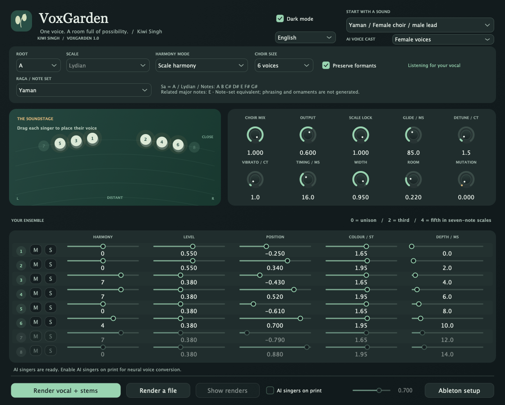
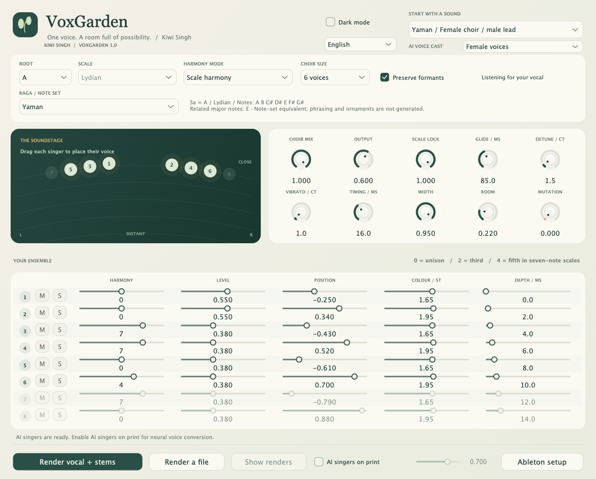
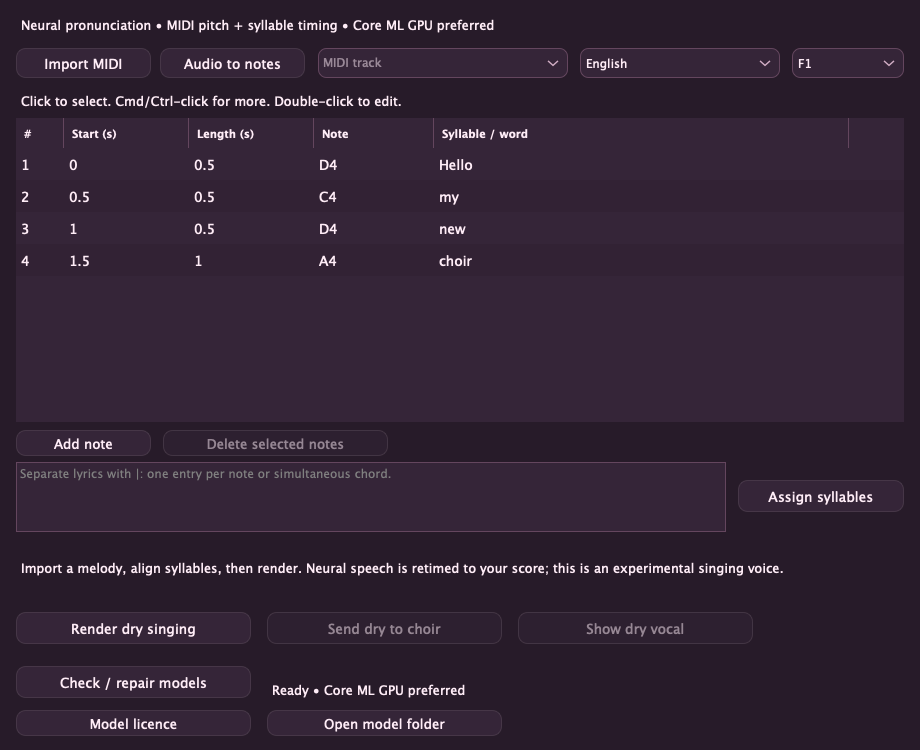
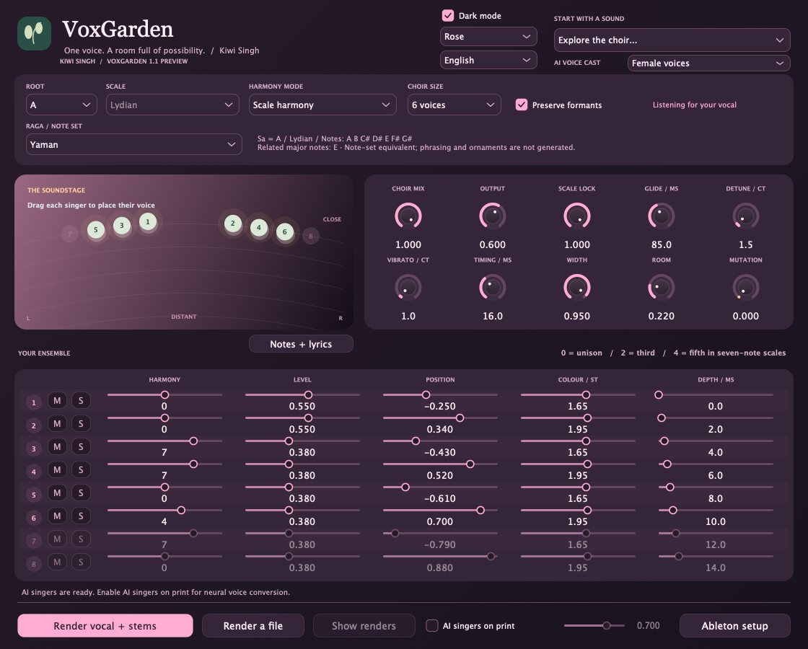

# VoxGarden — Kiwi Singh

**English** · [हिन्दी](README.hi.md) · [Deutsch](README.de.md) · [Nederlands](README.nl.md) · [Русский](README.ru.md)

A key-aware vocal choir effect by **Kiwi Singh**, with natural backing parts, playful voice transformations and optional local AI printing. **Version 1.0.0** · Apple Silicon macOS · VST3 + standalone.

## Screenshots



<details><summary>Light theme</summary>



</details>

## Source preview: notes + lyrics and colourful themes

The source tree now includes an **experimental score-to-singing workspace**: import standard MIDI, select a melody track, assign Unicode syllables and edit note names, start and duration in a table. Isolated audio supplies an editable monophonic pitch sketch. **Download voices inside the plugin** (~401 MB of models plus a private runtime/cache), choose from ten voices, then render a dry vocal or send it to the fast DSP choir. **Supertonic 3 neural pronunciation + PSOLA** retiming supports English, Hindi in Devanagari, German, Japanese, Russian and Dutch. **Core ML with GPU-preferred settings** handles neural inference; CPU handles score retiming and unsupported graph operations. This is speech adapted into singing, not a trained singing model; naturalness needs auditioning. **Rose, Ocean and Sunset** each offer light and dark variants. These additions are not in the v1.0.0 download below. [Workflow, benchmarks and limits](Singing.md).




<details><summary>Rose / 🌸</summary>



</details>

## SnappySnap support

Load VoxGarden VST3 as an effect in **SnappySnapFX**, then save different harmony, voice-count, formant and Mutation settings as **Snaps**. This lets one choir move between natural and unusual sounds. Sound parameters and host-state restoration are supported. End-to-end morphing has been confirmed by the user with Electric Smudge's official seven-day SnappySnapFX trial. Offline AI/singing renders are files, not a real-time morphable synthesis engine.

## What it does

- **SnappySnapFX support:** host VoxGarden and store different sound settings as Snaps; see the compatibility notes below.
- **1–8 choir voices**, with individual harmony, level, pan, formant and depth controls; per-voice mute and additive solo.
- **62 factory sounds**, including female-choir/male-lead and male-choir/female-lead textures.
- **Eight raga-inspired families:** Yaman, Bhupali, Kafi, Bhairavi, Bhairav, Malkauns, Durga and Hamsadhwani. Each has an original sound and both voice-cast variants, alongside Western note-set names and transposed notes.
- Scale harmony, MIDI chords and chromatic intervals; timing, detune, vibrato, room and experimental Mutation.
- **Capture the input of its own track**, then export a choir mix and aligned voice stems. Capture and printing monitor the dry vocal.
- Optional **Seed-VC AI printing**, with female, male, original mixed or alternating reference casts. After setup, conversion stays local and offline.
- Light/dark themes and English, Hindi, German, Dutch and Russian interfaces, saved per instance.

## Download and install

[**Download v1.0.0 for Apple Silicon macOS**](https://github.com/KiwiSingh/VoxGarden/releases/download/v1.0.0/VoxGarden-1.0-macOS-arm64.zip) · [All releases](https://github.com/KiwiSingh/VoxGarden/releases)

1. Extract the ZIP and close your audio host.
2. Run **Install.command**. It installs the VST3 in your user plugin folder and backs up an earlier VoxGarden installation.
3. Open/rescan Ableton Live and find **VST3 → Kiwi Singh → VoxGarden**.

The package includes a standalone app. The native build targets macOS 12+; supplied binaries are arm64. Intel/Windows/Linux binaries and an AU package are not supplied. Builds are ad-hoc signed, not Apple-notarized. The installer repairs the download marker only on this signature-verified plugin.

## Use in Ableton Live

Choose the song's **Root / Sa**, then a scale or raga and a starting sound. Under **Raga-inspired choirs**, open a raga submenu for its three variants. Western relationships describe the selected note collection; they do not detect your song's key. [Raga / Western-note guide](Ragas.md).

Click **Render vocal + stems**, play the passage in Live, then **Stop + render**. The plugin captures its input before its own processing, including earlier effects in the chain. Output appears in `Music/VoxGarden Renders`: original input, Choir Mix and numbered voice WAVs. The print uses settings at Stop, not captured automation. File rendering and drag/drop are also available.

**M** preserves a voice's level while muting it. Multiple **S** solos combine; mute takes precedence. Set Choir Mix to 100% to hear soloed choir parts without the dry lead. Excluded printed stems remain aligned and silent.

Keep Delay Compensation enabled: DSP latency is about **192 ms at 48 kHz**. Record a lead dry, then add the choir. Print MIDI-chord performances with Live's recorder. SnappySnapFX can host different parameter states as Snaps. The user has confirmed morphing with Electric Smudge's official trial.

For cross-track dragging, turn off **Settings → Plug-Ins → Auto-Hide Plug-In Windows** in Live, then open **Notes + lyrics**. The lyrics workspace floats above the host. Direct internal clip transfer remains unverified; use exported MIDI/audio files if the drag is not accepted.

## Optional AI singers

The new score-singing voices are downloaded inside **Notes + lyrics**. The separate setup below is only for the older Seed-VC voice-conversion workflow.

Run **Setup AI.command** from the release package once, or `bash "AI/Setup AI.command"` from this source tree. It needs Git and either **uv** or **Python 3.10**, plus internet access and several GB for initial model setup. Existing model downloads can be reused when updating.

Enable **AI singers on print** and choose **AI Voice Cast**. Live playback remains DSP; neural conversion happens during printing. Import the rendered mix/stems into Live to hear the AI result. Longer takes and larger choirs take longer; progress shows the singer and synthesis steps. Cancel retains the source take.

The attributed VCTK reference pack has five female and three male speech references, cycled for larger casts. It is not a sampled professional choir. Pronunciation, timing and naturalness depend on the source. Raga masks constrain notes; pakad, meend, gamakas and direction-specific phrasing still come from your vocal. [AI details](AI/README.md) · [Voice credits](AI/Voices/ATTRIBUTION.txt).

## Build from source

Requires a C++17 toolchain, CMake 3.24+, Ninja and Git on macOS. Dependencies are pinned by commit.

```sh
git clone https://github.com/KiwiSingh/VoxGarden.git
cd VoxGarden
bash prepare-deps.sh
cmake -S . -B build -G Ninja -DCMAKE_BUILD_TYPE=Release -DCMAKE_OSX_ARCHITECTURES=arm64
cmake --build build --target VoxGarden_VST3 VoxGarden_Standalone VoxGardenCheck
ctest --test-dir build --output-on-failure
```

Artifacts are under `build/VoxGarden_artefacts/Release`. See [validation](VALIDATION.txt), [audit checklist](Audit-1.0.md) and [contributing](CONTRIBUTING.md). No AI weights or private input vocals are committed.

## License and credits

VoxGarden uses the **GNU AGPL v3** license included in [LICENSE](LICENSE). Dependency licenses remain separate: [JUCE](Licenses/JUCE.md), [Signalsmith Stretch](Licenses/Signalsmith-Stretch.txt), [Signalsmith Linear](Licenses/Signalsmith-Linear.txt), and [Seed-VC GPL v3](Licenses/Seed-VC-GPL-3.0.txt). VCTK references are **CC BY 4.0**, with attribution and corpus metadata in [AI/Voices](AI/Voices). This is an independent project; no Cymatics code, assets or presets are included.

## ☕️ Support the Project

[](https://ko-fi.com/kiwisingh)
