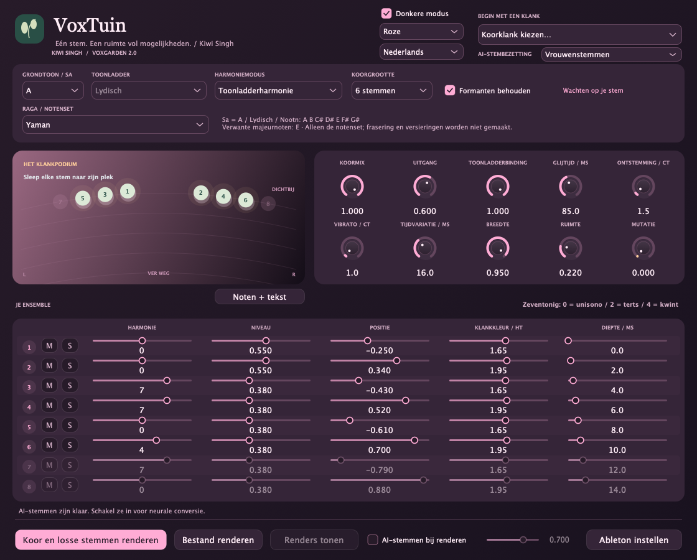
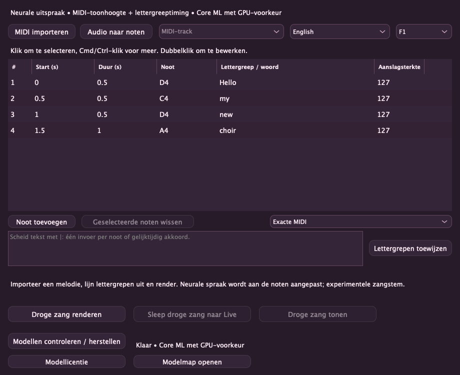

# VoxGarden — Kiwi Singh

[English](README.md) · [हिन्दी](README.hi.md) · [Deutsch](README.de.md) · **Nederlands** · [Русский](README.ru.md)

Een toonsoortbewust zangkooreffect van **Kiwi Singh**, met natuurlijke achtergrondzang, speelse stemtransformaties en optioneel lokaal AI-renderen. **Versie 2.0.0** · Apple Silicon-macOS · VST3 + standalone.

## Schermafbeeldingen



## Nieuw in 2.0: noten + tekst en kleurrijke thema’s

De broncode bevat een **experimentele werkruimte voor noten naar zang**: importeer standaard MIDI, kies een melodietrack, wijs Unicode-lettergrepen toe en bewerk nootnamen, start en duur in een tabel. Geïsoleerde audio levert een bewerkbare eenstemmige notenschets. **Download stemmen in de plugin** (~401 MB modellen plus eigen runtime/cache), kies uit tien stemmen en render droge zang en gebruik **Sleep droge zang naar Live** om deze op de audiotrack met VoxGarden te zetten en harmonieën vóór het printen te beluisteren en aan te passen. **Supertonic 3 voor neurale uitspraak + PSOLA** voor timing/toonhoogte ondersteunt Engels, Hindi in Devanagari, Duits, Japans, Russisch en Nederlands. **Core ML geeft de GPU voorrang**; timing en niet-ondersteunde graafbewerkingen gebruiken de CPU. Dit is spraak aangepast naar zang, geen getraind zangmodel; beluister de natuurlijkheid. **Roze, Oceaan en Zonsondergang** hebben lichte/donkere varianten. [Werkwijze, metingen en grenzen (Engels)](Singing.md).




<details><summary>Rose / 🌸</summary>


</details>

MIDI-akkoorden en overlappende noten behouden hun duur, ook bij herhaalde toonhoogten. Klik om een rij te selecteren; Cmd/Ctrl-klik selecteert meerdere noten, Shift-klik een bereik en dubbelklik bewerkt een cel. Tekst kan per noot of gelijktijdig akkoord worden toegewezen.

## SnappySnap-ondersteuning

Laad VoxGarden VST3 als effect in **SnappySnapFX** en bewaar verschillende instellingen voor harmonie, aantal stemmen, formanten en Mutation als **Snaps**. Zo kan het koor tussen natuurlijke en vreemde klanken bewegen. Klankparameters en herstel van de hoststatus worden ondersteund. De gebruiker heeft volledige morphing bevestigd met de officiële zevendaagse SnappySnapFX-proefversie van Electric Smudge. Offline AI- en zangrenders zijn bestanden, geen realtime morphbare synthese.

## Functies

- **SnappySnapFX-ondersteuning:** host VoxGarden en sla verschillende klankinstellingen op als Snaps; zie de compatibiliteitsnotities hieronder.
- **1–8 koorstemmen**, elk met harmonie, niveau, pan, formanten en diepte; dempen en combineerbare solo per stem.
- **62 fabrieksklanken**, waaronder vrouwenkoor voor mannenlead en mannenkoor voor vrouwenlead.
- **Acht ragafamilies:** Yaman, Bhupali, Kafi, Bhairavi, Bhairav, Malkauns, Durga en Hamsadhwani. Elke familie heeft de oorspronkelijke klank en beide stemvarianten, met westerse notensets en getransponeerde noten.
- Toonladderharmonie, MIDI-akkoorden, chromatische intervallen, timing, ontstemming, vibrato, ruimte en experimentele Mutatie.
- **De invoer van de eigen track opnemen**, daarna koormix en uitgelijnde losse stemmen renderen. Tijdens opname en renderen hoor je de droge zang.
- Optioneel **Seed-VC AI-renderen**, met vrouwelijke, mannelijke, oorspronkelijke gemengde of afwisselende referentiestemmen. Na de installatie lokaal en offline.
- Licht/donker thema en Engels, Hindi, Duits, Nederlands en Russisch; taal per instantie opgeslagen.

## Downloaden en installeren

[**Download v2.0.0 voor Apple Silicon-macOS**](https://github.com/KiwiSingh/VoxGarden/releases/download/v2.0.0/VoxGarden-2.0.0-macOS-arm64.zip) · [Alle releases](https://github.com/KiwiSingh/VoxGarden/releases)

1. Pak de ZIP uit en sluit je audiohost.
2. Voer **Install.command** uit. Het VST3 wordt in je gebruikersmap geïnstalleerd; een oudere VoxGarden-installatie krijgt een reservekopie.
3. Open/herscan Ableton Live: **VST3 → Kiwi Singh → VoxGarden**.

De standalone-app is inbegrepen. De native build richt zich op macOS 12+; de bestanden zijn arm64. Er zijn geen Intel-/Windows-/Linux-binaries of AU-pakket. De build is ad-hoc ondertekend, niet door Apple genotariseerd. Het installatieprogramma herstelt alleen de downloadmarkering van deze gecontroleerde plugin.

## Gebruik in Ableton Live

Kies de **grondtoon / Sa** van je nummer, daarna een toonladder of raga en een beginklank. Onder **Door raga geïnspireerde koren** heeft elke raga een submenu met drie varianten. De westerse relatie beschrijft de gekozen notenset; de toonsoort wordt niet automatisch gedetecteerd. [Raga-/notengids](Ragas.md).

Klik op **Koor en losse stemmen renderen**, speel de passage in Live af en klik op **Stoppen en renderen**. VoxGarden neemt vóór de eigen verwerking op, inclusief eerdere effecten in de track. In `Music/VoxGarden Renders` vind je de bronopname, Choir Mix en genummerde stem-WAV's. De instellingen bij Stop worden gebruikt; automatisering tijdens de opname wordt niet vastgelegd. Bestandsrenderen en slepen/neerzetten zijn ook beschikbaar.

**M** dempt zonder het niveau te wijzigen. Meerdere **S**-solo's spelen samen; dempen heeft voorrang. Zet Koormix op 100% om alleen de solostemmen te horen. Uitgesloten stemmen blijven uitgelijnde, stille bestanden.

Laat Delay Compensation aan: ongeveer **192 ms DSP-vertraging bij 48 kHz**. Neem de lead eerst droog op. Neem MIDI-akkoorden met de recorder van Live op. SnappySnapFX kan verschillende parameterstanden als Snaps hosten. De gebruiker heeft morphing bevestigd met de officiële proefversie van Electric Smudge.

Zet voor slepen vanaf een andere track in Live **Settings → Plug-Ins → Auto-Hide Plug-In Windows** uit en open **Noten + tekst**. Dit venster blijft boven de host. Exporteer MIDI-clips eerst als .mid; rechtstreeks slepen van interne MIDI-clips blijft een bekende beperking.

## Optionele AI-stemmen

De nieuwe zangmodellen download je in **Noten + tekst**. De aparte installatie hieronder is alleen voor de oudere Seed-VC-stemconversie.

Voer **Setup AI.command** uit het releasepakket eenmaal uit, of `bash "AI/Setup AI.command"` vanuit de broncode. Git en **uv** of **Python 3.10**, internet en meerdere GB voor de eerste modelinstallatie zijn nodig. Bestaande modeldownloads kunnen bij updates worden hergebruikt.

Schakel **AI-stemmen bij renderen** in en kies **AI-stembezetting**. Live blijft DSP; neurale conversie gebeurt tijdens renderen. Importeer de resultaten in Live om de AI-versie te horen. Langere opnamen en grotere koren kosten meer tijd; de voortgang toont stem en synthesestappen. Annuleren bewaart de bronopname.

Het VCTK-pakket bevat vijf vrouwelijke en drie mannelijke spraakreferenties, die voor grotere bezettingen worden herhaald. Het is geen gesampled professioneel koor. Uitspraak, timing en natuurlijkheid hangen van de bron af. Ragamaskers begrenzen noten; pakad, meend, gamaka's en richtingsgebonden frasering komen uit je zang. [AI-details](AI/README.md) · [Stemvermelding](AI/Voices/ATTRIBUTION.txt).

## Bouwen vanuit broncode

Vereist C++17, CMake 3.24+, Ninja en Git op macOS. Afhankelijkheden zijn op commits vastgezet.

```sh
git clone https://github.com/KiwiSingh/VoxGarden.git
cd VoxGarden
bash prepare-deps.sh
cmake -S . -B build -G Ninja -DCMAKE_BUILD_TYPE=Release -DCMAKE_OSX_ARCHITECTURES=arm64
cmake --build build --target VoxGarden_VST3 VoxGarden_Standalone VoxGardenCheck
ctest --test-dir build --output-on-failure
```

Uitvoer: `build/VoxGarden_artefacts/Release`. Zie [validatie](VALIDATION.txt), [audit](Audit-1.0.md) en [bijdragen](CONTRIBUTING.md). Geen AI-gewichten of privézangopnamen in de repository.

## Licentie en credits

VoxGarden gebruikt **GNU AGPL v3**: [LICENSE](LICENSE). Afhankelijkheden behouden hun eigen licenties: [JUCE](Licenses/JUCE.md), [Signalsmith Stretch](Licenses/Signalsmith-Stretch.txt), [Signalsmith Linear](Licenses/Signalsmith-Linear.txt), [Seed-VC GPL v3](Licenses/Seed-VC-GPL-3.0.txt). VCTK-referenties: **CC BY 4.0**, met bronvermelding en metadata in [AI/Voices](AI/Voices). Onafhankelijk project zonder code, materiaal of presets van Cymatics.

## Zang op basis van akkoorden

Kies in **Notes + lyrics** exacte MIDI, akkoorden op aanslag of op grondtoon. MIDI-aanslagsterkte (1–127) wordt geïmporteerd en is bewerkbaar. Akkoordmodi groeperen noten met minstens 30 ms gezamenlijke overlap of een start binnen 2 ms. Ze delen het woord van de leidende noot en mengen die luider dan de harmonieën. Wijs één lettergreep per groep of noot toe. Aanslagmodus kiest de sterkste noot; bij gelijke aanslag de laagste. Grondtoonmodus herkent gangbare drie- en septiemklanken, ook omkeringen; bij twijfel wordt de bas gebruikt. Oorspronkelijke noten en lengtes blijven behouden. Dit regelt woorden en mengbalans, geen expressieve neurale klemtoon.

**Ableton-MIDI-import:** exporteer de clip eerst als `.mid` en importeer of sleep dat bestand naar VoxGarden. Rechtstreeks slepen van interne MIDI-clips blijft een bekende beperking. Droge WAV-overdracht en beluisteren in Live zijn door de gebruiker bevestigd. Neurale zang vereist Apple Silicon macOS 14+; de DSP-plugin richt zich op macOS 12+.

## ☕️ Steun het project

[](https://ko-fi.com/kiwisingh)
