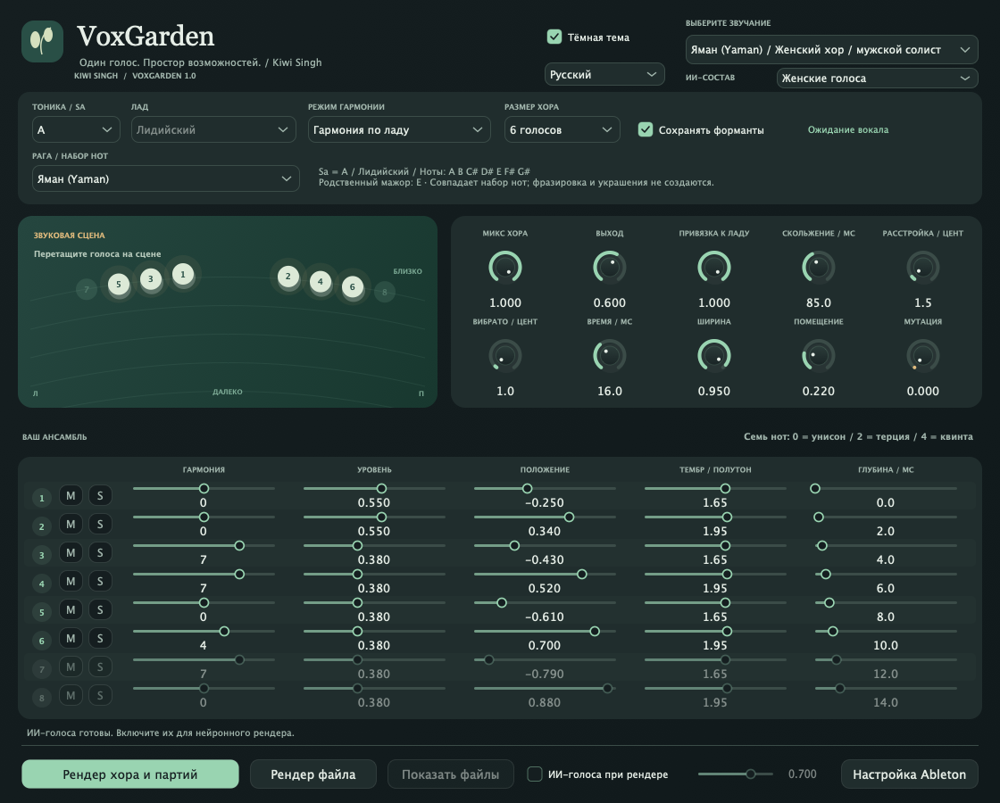
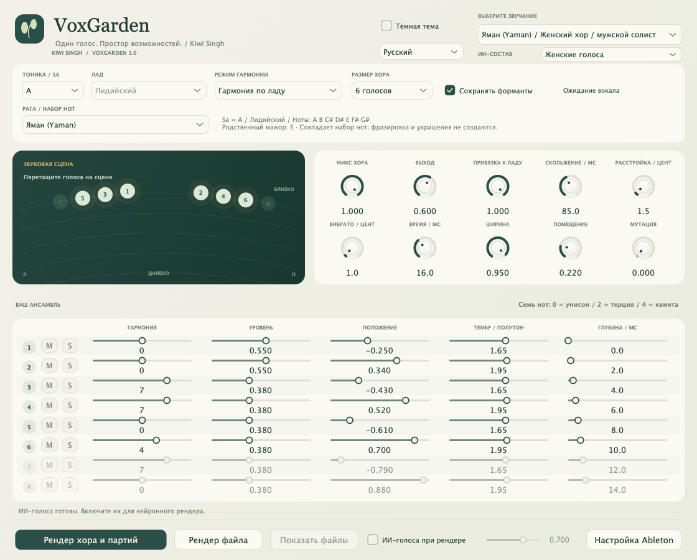
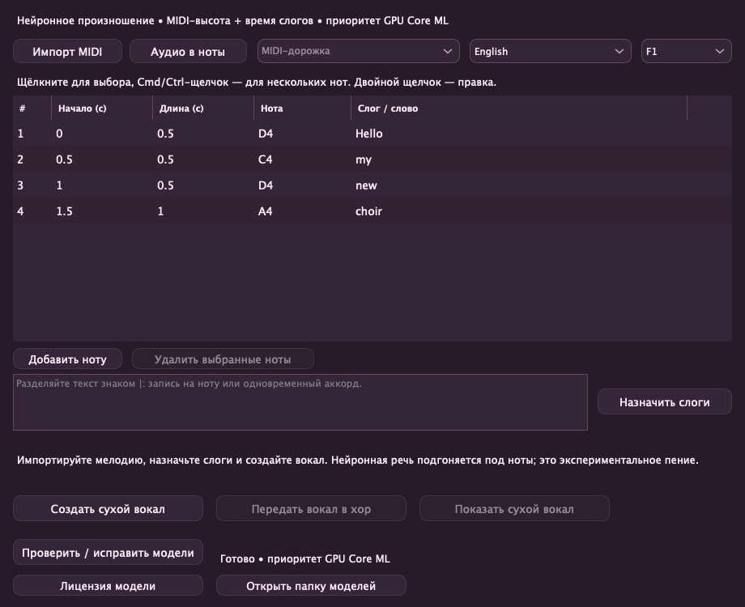
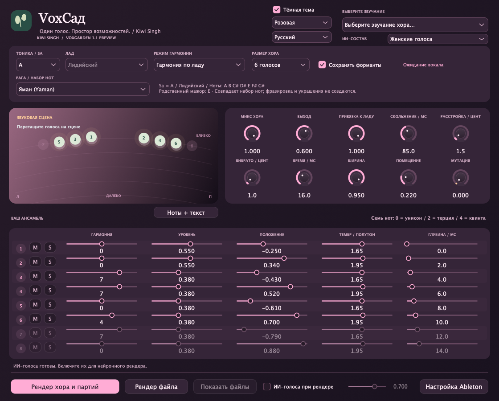

# VoxGarden — Kiwi Singh

[English](README.md) · [हिन्दी](README.hi.md) · [Deutsch](README.de.md) · [Nederlands](README.nl.md) · **Русский**

Хоровой вокальный эффект от **Kiwi Singh** с привязкой к тональности, естественным бэк-вокалом, творческим преобразованием голосов и локальным ИИ-рендером. **Версия 1.0.0** · macOS на Apple Silicon · VST3 и standalone.

## Скриншоты



<details><summary>Светлая тема</summary>



</details>

## Предварительная версия из исходников: ноты + текст и цветные темы

В исходниках есть **экспериментальная среда пения по нотам**: импорт стандартного MIDI, выбор мелодии, слоги Unicode и правка названий нот, начала и длины в таблице. Изолированное аудио даёт редактируемый одноголосный набросок. **Скачивайте голоса прямо в плагине** (~401 МБ моделей плюс отдельная среда/кэш), выбирайте один из десяти голосов и создавайте сухой вокал либо передавайте его в быстрый DSP-хор. **Нейронное произношение Supertonic 3 + PSOLA** для времени/высоты поддерживает английский, хинди в деванагари, немецкий, японский, русский и нидерландский. **Core ML отдаёт приоритет GPU**; изменение времени и неподдерживаемые операции графа выполняет CPU. Это речь, подогнанная под ноты, а не обученная модель пения; естественность нужно оценить на слух. **Розовая, Океан и Закат** имеют светлый/тёмный варианты. Не входит в загрузку v1.0.0 ниже. [Процесс, замеры и ограничения (английский)](Singing.md).

- **Поддержка SnappySnapFX:** загружайте VoxGarden и сохраняйте разные настройки звука в Snaps; подробности совместимости ниже.



<details><summary>Rose / 🌸</summary>



</details>

MIDI-аккорды и пересекающиеся ноты сохраняют длительность, включая повтор одной высоты. Щелчок выбирает строку, Cmd/Ctrl-щелчок — несколько нот, Shift-щелчок — диапазон, двойной щелчок редактирует ячейку. Текст назначается на ноту или одновременный аккорд.

## Поддержка SnappySnap

Загрузите VoxGarden VST3 как эффект в **SnappySnapFX** и сохраните разные настройки гармонии, числа голосов, формант и Mutation в **Snaps**. Так хор может переходить от естественных к необычным звукам. Поддерживаются звуковые параметры и восстановление состояния хоста. Пользователь подтвердил полный процесс морфинга в официальной семидневной пробной версии SnappySnapFX от Electric Smudge. Офлайн-рендеры ИИ и пения — файлы, а не синтез с морфингом в реальном времени.

## Возможности

- **1–8 голосов** с отдельными настройками гармонии, уровня, панорамы, формант и глубины; отключение и совместное соло нескольких партий.
- **62 заводских звучания**, включая женский хор для мужского солиста и мужской хор для женской солистки.
- **Восемь семейств раг:** Яман, Бхупали, Кафи, Бхайрави, Бхайрав, Малкаунс, Дурга и Хамсадхвани. Для каждой — исходное звучание и два состава, с западными названиями ладов и транспонированными нотами.
- Гармония по ладу, MIDI-аккорды, хроматические интервалы, временные вариации, расстройка, вибрато, помещение и экспериментальная мутация.
- **Запись входа собственной дорожки**, затем рендер хора и выровненных партий. Во время записи и рендера слышен сухой вокал.
- Необязательный **ИИ-рендер Seed-VC** с женским, мужским, исходным смешанным или чередующимся составом. После настройки преобразование локальное и офлайн.
- Светлая/тёмная тема и английский, хинди, немецкий, нидерландский и русский интерфейсы; язык сохраняется для каждого экземпляра.

## Загрузка и установка

[**Скачать v1.0.0 для macOS на Apple Silicon**](https://github.com/KiwiSingh/VoxGarden/releases/download/v1.0.0/VoxGarden-1.0-macOS-arm64.zip) · [Все версии](https://github.com/KiwiSingh/VoxGarden/releases)

1. Распакуйте ZIP и закройте аудиохост.
2. Запустите **Install.command**. VST3 устанавливается в пользовательскую папку плагинов; предыдущая установка VoxGarden сохраняется в резервной копии.
3. Откройте/пересканируйте Ableton Live: **VST3 → Kiwi Singh → VoxGarden**.

Включено standalone-приложение. Нативная сборка рассчитана на macOS 12+; бинарные файлы — arm64. Сборок Intel/Windows/Linux и пакета AU нет. Подпись ad-hoc, без нотариализации Apple. Установщик исправляет отметку загрузки только у этого плагина с проверенной подписью.

## Использование в Ableton Live

Выберите **тонику / Sa** песни, лад или рагу и начальное звучание. В разделе **Хоры по мотивам раг** подменю каждой раги содержит три варианта. Западное соответствие описывает выбранные ноты, а не автоматически определённую тональность песни. [Раги и западные ноты](Ragas.md).

Нажмите **Рендер хора и партий**, проиграйте фрагмент в Live и нажмите **Стоп и рендер**. Записывается вход до обработки самим VoxGarden, включая предыдущие эффекты дорожки. В `Music/VoxGarden Renders` находятся исходная запись, Choir Mix и пронумерованные WAV-файлы голосов. Используются настройки в момент остановки; автоматизация во время записи не сохраняется. Доступны рендер файла и перетаскивание.

**M** отключает голос, сохраняя уровень. Несколько **S** звучат соло вместе; отключение имеет приоритет. Чтобы слышать только сольные партии без сухого вокала, установите микс хора на 100%. Исключённые партии остаются выровненными файлами с тишиной.

Оставьте Delay Compensation включённой: задержка DSP — около **192 мс при 48 кГц**. Сначала записывайте солиста без эффекта. MIDI-аккорды записывайте рекордером Live. SnappySnapFX может хранить состояния параметров как Snaps. Пользователь подтвердил морфинг в официальной пробной версии Electric Smudge.

Для перетаскивания с другой дорожки отключите в Live **Settings → Plug-Ins → Auto-Hide Plug-In Windows** и откройте **Ноты + текст**. Это окно остаётся поверх хоста. Прямая передача внутренних клипов ещё не проверена; если перетаскивание не принимается, используйте экспортированные MIDI-/аудиофайлы.

## Необязательные ИИ-голоса

Новые модели пения скачиваются в окне **Ноты + текст**. Отдельная установка ниже нужна только для прежнего преобразования голоса Seed-VC.

Один раз запустите **Setup AI.command** из пакета либо `bash "AI/Setup AI.command"` из исходников. Нужны Git и **uv** или **Python 3.10**, интернет и несколько ГБ для первоначальной загрузки моделей. При обновлении уже загруженные модели можно использовать повторно.

Включите **ИИ-голоса при рендере** и выберите **ИИ-состав**. В реальном времени работает DSP; нейронное преобразование выполняется при рендере. Импортируйте результат в Live, чтобы услышать ИИ-версию. Длинные записи и большой хор требуют больше времени; отображаются голос и шаги синтеза. Отмена сохраняет исходную запись.

VCTK-пакет содержит пять женских и три мужских речевых референса, повторяемых в больших составах. Это не сэмплированный профессиональный хор. Произношение, синхронизация и естественность зависят от источника. Маски раг ограничивают ноты; пакад, минд, гамаки и направленная фразировка поступают из вокала. [Подробности об ИИ](AI/README.md) · [Источники голосов](AI/Voices/ATTRIBUTION.txt).

## Сборка из исходников

Требуются C++17, CMake 3.24+, Ninja и Git на macOS. Зависимости закреплены по коммитам.

```sh
git clone https://github.com/KiwiSingh/VoxGarden.git
cd VoxGarden
bash prepare-deps.sh
cmake -S . -B build -G Ninja -DCMAKE_BUILD_TYPE=Release -DCMAKE_OSX_ARCHITECTURES=arm64
cmake --build build --target VoxGarden_VST3 VoxGarden_Standalone VoxGardenCheck
ctest --test-dir build --output-on-failure
```

Результаты — в `build/VoxGarden_artefacts/Release`. См. [проверки](VALIDATION.txt), [аудит](Audit-1.0.md) и [участие в разработке](CONTRIBUTING.md). В репозитории нет весов ИИ или частных вокальных записей.

## Лицензия и авторство

VoxGarden использует **GNU AGPL v3**: [LICENSE](LICENSE). Лицензии зависимостей отдельные: [JUCE](Licenses/JUCE.md), [Signalsmith Stretch](Licenses/Signalsmith-Stretch.txt), [Signalsmith Linear](Licenses/Signalsmith-Linear.txt), [Seed-VC GPL v3](Licenses/Seed-VC-GPL-3.0.txt). Референсы VCTK — **CC BY 4.0**, с атрибуцией и метаданными в [AI/Voices](AI/Voices). Независимый проект без кода, материалов или пресетов Cymatics.

## ☕️ Поддержать проект

[](https://ko-fi.com/kiwisingh)
